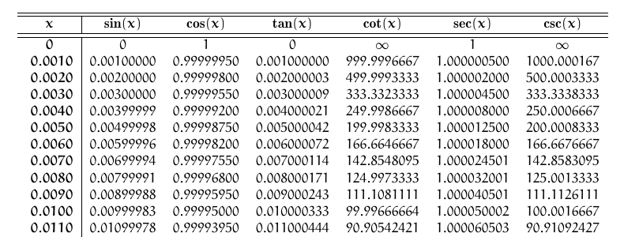

#+PROPERTY: header-args:ruby :results value :colnames no :hlines yes :exports both :dir "./"
#+PROPERTY: header-args:ruby+ :wrap example :session erbtex_session :eval yes
#+PROPERTY: header-args:ruby+ :prologue "$:.unshift('./lib') unless $:.first == './lib'; require 'erbtex'"
#+PROPERTY: header-args:ruby+ :ruby "bundle exec irb"
#+PROPERTY: header-args:sh :exports code :eval no
#+PROPERTY: header-args:bash :exports code :eval no
#+PROPERTY: header-args:latex :exports code :eval no

# gem_docs:version begin
Version: 0.5.0
# gem_docs:version end

* Introduction
~erbtex~ is a ruby gem that provides the ~erbtex~ command line program that
pre-processes TeX and LaTeX source files with ruby's [[http://www.kuwata-lab.com/erubis][erubis]] and then passes
the resulting file along to a real TeX program for compilation.  This
allows your TeX or LaTeX documents to do arbitrary calculations using
Ruby code when doing so in LaTeX would be infeasible.

For example, the [[file:examples/TrigTable.tex][trigonometry table source]] uses Ruby to compute
and format the values, while LaTeX lays out the table across multiple pages.
[[file:examples/TrigTable.pdf][View the typeset output (PDF)]] for the complete 32-page table.

Here is an excerpt from the first page:

* Installation
Install ~erbtex~ with:

#+BEGIN_SRC sh
  gem install erbtex
#+END_SRC

* Usage
After the gem is installed, ~erbtex~ is placed in your PATH. ~erbtex~
recognizes only one command-line option, ~--invoke=<tex_program>~, which
specifies what TeX variant will process the TeX file after erubis has
pre-proceesed the input file.  By default, ~erbtex~ uses ~pdflatex~ if no
--invoke option is given.

~Erbtex~ reads the input file and executes any ruby code between the
special delimiters ~{:~ and ~:}~.  This brace-colon form of delimiters
is less disruptive of LaTeX syntax highlighting than ~erubis~'s default
delimiters ~<%~ and ~%>~ delimiters, which often get confused by
syntax-enabled editors with TeX and LaTeX comments.

If the opening delimiter is instead ~{:=~, the delimited ruby expression is
converted into a string (with ruby's ~.to_s~ method) and inserted in-place
into the TeX manuscript at that point. For example, the text ~{:= "Hello,
world".reverse :}~ places the string ~dlrow ,olleH~ at that point in the TeX
file.

Any text /not/ enclosed in these delimiters is passed through untouched to the
TeX program.

Without the `=` the ruby code is simply executed. You can use these, for
example, to ~require~ ruby libraries or to embed loops into the file.  Loops
started in one delimited ruby fragment can be continued or terminated in a
later fragment, and variables defined in one fragment are accessible in later
fragments according to Ruby's usual scoping rules. The result is that you can
use the ruby programming language to greatly increase the computational
capabilities of a normal TeX or LaTeX.

You can get the version with the --version flag and help with --help.

To generate the preprocessed file without invoking TeX, use
~erbtex --preprocess-only roots.tex~. This writes ~roots.etx~ and exits;
an input named ~roots.tex.erb~ produces ~roots.tex~ instead. The option
requires an input file.

Generated output begins with this exact first-line comment:

#+BEGIN_SRC latex
% Generated by erbtex. Changes may be overwritten.
#+END_SRC

Erbtex automatically replaces an existing output file only when it starts
with that marker. Otherwise it prints a warning and exits unsuccessfully,
before executing the template or invoking TeX. Use ~--no-clobber~ to protect
all existing output files, including marked ones. This applies to both
~.tex~ and ~.etx~ output, including ~--preprocess-only~ mode.

Output generated by older erbtex versions has no marker and is protected.
Inspect it before moving or deleting it, or add the marker as its first line
if you want erbtex to overwrite it on subsequent runs.

Erbtex preprocesses only the input file given on the command line. Files
referenced by LaTeX's ~\input~ or ~\include~ commands are read directly by
TeX; Ruby fragments in those files are not evaluated by erbtex. Recursive
pre-processing of included files is not currently supported. If an included
file needs preprocessing, run erbtex on it separately with ~--preprocess-only~
and reference the generated output from the main document.

** Examples
*** Square Roots
For example, the following LaTeX file will produce a table of square
roots when run through erbtex.  It uses a ruby iterator to supply the
rows of the table, a feat that would tedious at best with bare TeX or
LaTeX.

#+BEGIN_SRC latex
  \documentclass{article}
  \usepackage[mathbf]{euler}
  \usepackage{longtable}

  \begin{document}
      \begin{longtable}[c]{r|r}
  \hline\hline
  \multicolumn{1}{c|}{\mathversion{bold}$x$}&
  \multicolumn{1}{c}{\mathversion{bold}\rule{0pt}{12pt}$\sqrt{x}$}\\
  \hline\hline
  \endhead
  \hline\hline
  \endfoot
  % The following line starts a ruby enumerator loop but does not
  % produce any output, since the delimiters are {: :}.
  {: 0.upto(100).each do |x| :}

  % But the following two lines produce output since the opening delimiter is
  % '{:='. Both call the sprintf method in ruby via the percent operator, and the
  % second line calls ruby's Math module to compute the square root. Notice that
  % the '%' inside the delimiters does not have the effect of commenting out
  % the following text. It is interpreted as a ruby '%' operator.

    {:= "\\mathversion{bold}$%0.4f$" % x :}&
    {:= "$%0.8f$" % Math.sqrt(x) :}\\

  % End of the loop started above.
  {: end :}
    \end{longtable}
  \end{document}
#+END_SRC

With the above in file ~roots.tex~, running ~$ erbtex roots.tex~ at the
command line will generate a `PDF` file with a nicely typeset table of square
roots.  The generated pdf file can be seen [[file:examples/roots.pdf][here]].  As a by-product, the
pre-processed file ~roots.etx~ is left in the same directory, so you can see
what the effect of the erbtex fragments were. This is often very handy when
you are trying to debug the document; otherwise, feel free to delete it. Here,
for example is a portion of the `roots.etx` file generated by the foregoing:

#+BEGIN_SRC latex
    \begin{document}
      \begin{longtable}[c]{r|r}
      \hline\hline
      \multicolumn{1}{c|}{\mathversion{bold}$x$}&
      \multicolumn{1}{c}{\mathversion{bold}\rule{0pt}{12pt}$\sqrt{x}$}\\
      \hline\hline
      \endhead
      \hline\hline
      \endfoot
      \mathversion{bold}$0.0000$&
      $0.00000000$\\
      \mathversion{bold}$1.0000$&
      $1.00000000$\\
      \mathversion{bold}$2.0000$&
      $1.41421356$\\
      \mathversion{bold}$3.0000$&
      $1.73205081$\\
      \mathversion{bold}$4.0000$&
      $2.00000000$\\
      \mathversion{bold}$5.0000$&
      $2.23606798$\\
      \mathversion{bold}$6.0000$&
      $2.44948974$\\
      \mathversion{bold}$7.0000$&
      $2.64575131$\\
      \mathversion{bold}$8.0000$&
      $2.82842712$\\
      \mathversion{bold}$9.0000$&
      $3.00000000$\\
      \mathversion{bold}$10.0000$&
      $3.16227766$\\
      \mathversion{bold}$11.0000$&
      $3.31662479$\\
      \mathversion{bold}$12.0000$&
      $3.46410162$\\
      \mathversion{bold}$13.0000$&
      $3.60555128$\\
      \mathversion{bold}$14.0000$&
      #+END_SRC

And many more lines like it.

*** Trigonometry Table
The examples directory installed with the erbtex gem has a few more
examples, including a [[file:examples/TrigTable2.pdf][large trigonometry table]] generated from a relatively
small [[file:examples/TrigTable2.tex][input file]].

It makes good use of ruby to define a Dms class that handles angles
expressed as degrees, minutes, and seconds---a feat that would be very
difficult to achieve with LaTeX also.
* ErbTeX: Ruby pre-processing for TeX and LaTeX Documents
